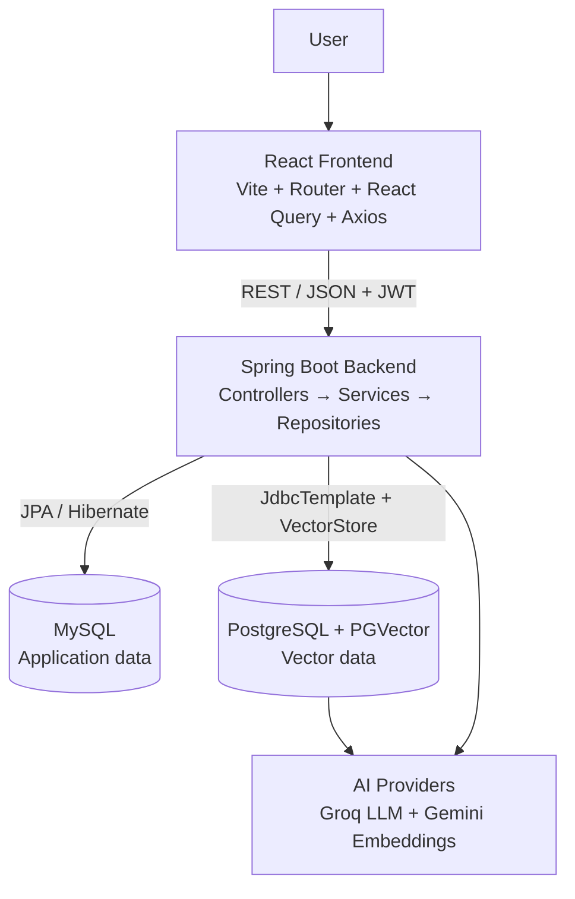
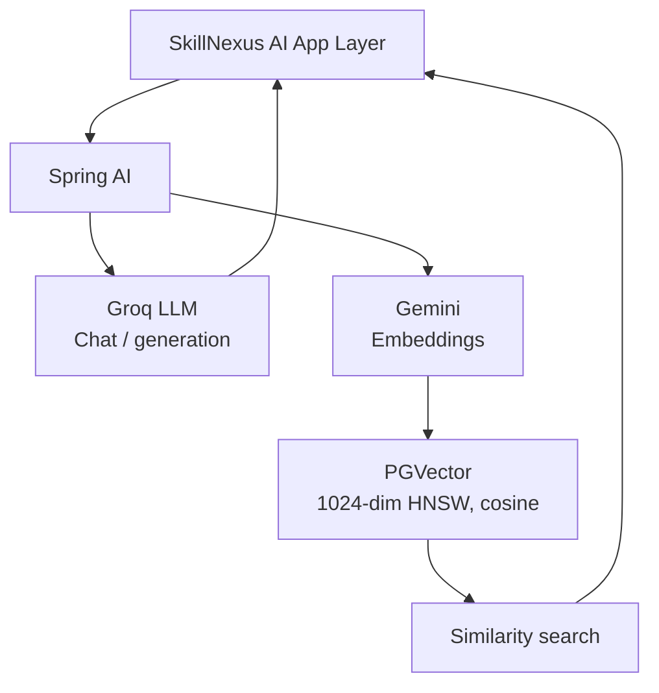
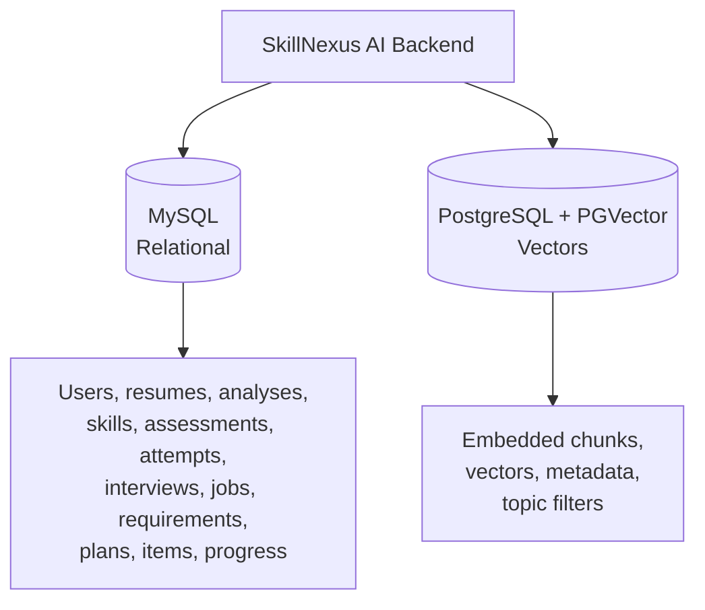
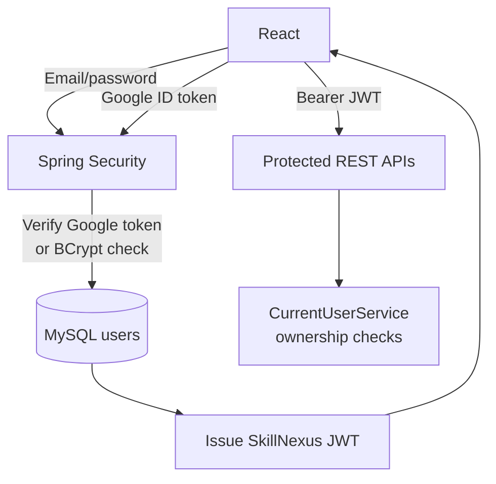

# SkillNexus AI

### Understand Your Skills. Close the Gaps. Build Your Future.

SkillNexus AI is an AI-powered **career intelligence platform** for resume analysis, technical skill assessment, job-description matching, interview practice, skill-gap analysis, personalized preparation plans, and context-aware career guidance.

It connects information that is normally scattered across tools — resume content, assessment performance, interview performance, target job requirements, and preparation progress — into one structured view that answers:

> **"How ready am I for my target technical role, and what should I work on next?"**

---

## Table of Contents

- [Overview and Problem Statement](#overview-and-problem-statement)
- [Features](#features)
- [Technology Stack](#technology-stack)
- [System Architecture and Data Flow](#system-architecture-and-data-flow)
- [AI Architecture](#ai-architecture)
- [Database Responsibilities](#database-responsibilities)
- [Authentication and Security](#authentication-and-security)
- [Project Structure](#project-structure)
- [Prerequisites](#prerequisites)
- [Local Setup](#local-setup)
- [Environment Variables](#environment-variables)
- [Running the Applications](#running-the-applications)
- [Database and PGVector Setup](#database-and-pgvector-setup)
- [Testing and Build](#testing-and-build)
- [API Documentation](#api-documentation)
- [Deployment Architecture and Limitations](#deployment-architecture-and-limitations)
- [Troubleshooting](#troubleshooting)
- [Security Guidance](#security-guidance)
- [Roadmap](#roadmap)
- [Acknowledgments and Attribution](#acknowledgments-and-attribution)
- [License](#license)

---

## Overview and Problem Statement

Career preparation is fragmented. A developer may use one tool for resume feedback, another for quizzes, another for interview practice, and another for reading job descriptions. None of these tools share context, so guidance stays generic.

SkillNexus AI addresses this by keeping a persistent, user-scoped technical profile and reusing it across modules:

```text
Resume + Skills + Assessments + Interviews + Target Job + Progress
                          ↓
                Skill intelligence
                          ↓
                 Skill-gap analysis
                          ↓
                 Preparation plan
                          ↓
              Context-aware Career Coach
```

Unlike a generic chatbot, the Career Coach uses application tools, retrieved knowledge, and conversation memory to answer questions about the user's own profile without inventing skills, experience, or achievements.

---

## Features

### Implemented and verified in code

| Area | What exists |
|---|---|
| Resume Intelligence | PDF/DOCX upload, type validation, Apache Tika text extraction, AI analysis, section-wise analysis, strengths/weaknesses, missing elements, improvement recommendations, technology extraction, resume summary, deterministic scoring service with unit tests |
| Technical Skill Intelligence | Technology catalog, resume-derived technologies, skill dashboard, per-technology detail, readiness signal, skill progress tracking fed by assessments and interviews |
| Technology Assessments | Technology + difficulty selection, AI-generated MCQ assessments, attempts, answer submission, result calculation, skill-progress integration; MCQ-only is enforced in code |
| AI Mock Interviews | Technology-specific interviews, AI-generated questions, answer submission, completion flow, AI evaluation with structured feedback, result view, skill-progress integration |
| Job Description Intelligence | Job description creation, AI requirement analysis, required technologies/skills extraction |
| Resume-to-Job Matching | Resume + job comparison endpoint, requirement-level matching response, skill-gap derivation |
| Skill-Gap Analysis | Gaps derived from resume technologies, job requirements, assessment performance, and interview performance |
| Preparation Plans | Plan creation, AI-assisted `GET /generate` flow, activation, per-item status updates, progress tracking |
| AI Career Coach | Context-aware assistant with JWT protection, conversation ID-scoped memory, application tool calling, Markdown responses, non-streaming `POST` plus SSE-style streaming `POST /stream` |
| RAG and Knowledge Base | Knowledge document ingestion, chunking, Gemini embeddings, PGVector storage, filtered similarity search, grounded answer generation with sources |
| Resume Storage | Local filesystem storage under `storage/resumes`, 5 MB upload limits |
| API Docs | SpringDoc OpenAPI + Swagger UI |
| Frontend | Landing, login/register with Google Sign-In, dashboard, resume, skills, assessments, interviews, jobs, preparation, Career Coach; service + hook + page architecture with React Query and Axios |

### Planned or unverified

These are either future work or could not be verified locally without credentials, databases, or hosted services:

- Production deployment health, cold-start behavior, and live demo availability
- RAG answer quality at scale and large knowledge-base behavior
- Persistent resume storage on ephemeral hosts — object storage is not implemented
- Advanced analytics, additional assessment types beyond MCQ, and expanded Coach tool coverage
- Performance, load, and AI-cost characteristics under real traffic

No live URLs, screenshots, badges, user counts, or performance claims are included because they were not verified during this rename.

---

## Technology Stack

### Backend

| Technology | Actual purpose in this repo |
|---|---|
| Java 21 | Backend language |
| Spring Boot 4.0.8 | Application framework, REST APIs, configuration |
| Spring Security + OAuth2 Resource Server | Stateless JWT protection, route authorization |
| JWT | Stateless session token for API calls |
| Spring Data JPA + Hibernate | Relational persistence for MySQL |
| Maven | Build and dependency management |
| Spring AI 2.0.1 BOM | Chat, embeddings, vector store abstractions |
| `spring-ai-starter-model-openai` | Chat model client pointed at Groq's OpenAI-compatible endpoint |
| `spring-ai-starter-model-google-genai-embedding` | Gemini text embeddings |
| `spring-ai-starter-vector-store-pgvector` | PGVector vector store integration |
| Apache Tika 3.3.2 | Resume text extraction from PDF/DOCX |
| google-api-client 2.9.1 | Google ID token verification for Sign-In |
| SpringDoc OpenAPI 3.1.1 | Swagger UI and OpenAPI docs |
| MySQL connector | Runtime driver for application database |
| PostgreSQL driver + HikariCP | Runtime driver and pool for PGVector datasource |
| Reactor | `Flux` streaming for Career Coach |

### Frontend

| Technology | Actual purpose |
|---|---|
| React 19 | UI framework |
| Vite 8 | Dev server and production build |
| Tailwind CSS 4 | Styling |
| React Router 7 | Public and protected client routes |
| TanStack React Query 5 | Server-state fetching, caching, mutations |
| Axios | HTTP client with JWT interceptor and 401 handling |
| React Markdown + remark-gfm | Rendering Coach Markdown responses |
| Google Identity Services | Browser Google Sign-In button flow; ID token sent to backend |

### Data and AI services

| Technology | Purpose |
|---|---|
| MySQL | Primary relational store: users, resumes, skills, assessments, interviews, jobs, plans |
| PostgreSQL + PGVector | Vector store: embedded knowledge chunks, metadata, similarity search |
| Groq | Chat/LLM generation via OpenAI-compatible API; configured model `openai/gpt-oss-20b` |
| Gemini | `gemini-embedding-001` embeddings at 1024 dimensions |
| Docker | Multi-stage backend container build |

---

## System Architecture and Data Flow

SkillNexus AI is a **modular monolith**: one Spring Boot backend holds all business capabilities; the React frontend calls it over REST.



Typical local request flow:

```text
React Page
    ↓
React Query hook
    ↓
Service module
    ↓
Axios client (+ JWT from localStorage)
    ↓
Spring Boot controller
    ↓
Service + CurrentUserService (ownership scope)
    ↓
JPA repository → MySQL
and/or VectorStore → PGVector → Groq/Gemini
```

End-to-end preparation flow:

```text
Register / Login
        ↓
    Dashboard
        ↓
Upload Resume → Tika extraction → AI analysis → Technologies → Skill profile
        ↓
Assessments + Mock Interviews → Performance signals
        ↓
Analyze Job Description → Match Resume ↔ Job → Skill gaps
        ↓
Generate Preparation Plan → Track progress
        ↓
Ask Career Coach (tools + memory + RAG context)
```

---

## AI Architecture

Different AI capabilities are used for different needs. Stateless operations stay stateless; only the Coach and RAG paths use conversation context.



| Provider / component | Responsibility |
|---|---|
| Groq | Chat and structured generation: resume analysis, recommendations, assessment questions, interview questions/evaluation, job analysis, Coach answers |
| Gemini | Text embeddings for knowledge indexing and retrieval |
| PGVector | `vector_store` table, HNSW cosine search, metadata filtering by topic |
| Spring AI | `ChatClient`, `EmbeddingModel`, `VectorStore`, `MessageWindowChatMemory` wiring |

### Retrieval-Augmented Generation

```text
Knowledge documents
        ↓
Character chunking
        ↓
Gemini embeddings (1024 dims)
        ↓
PGVector
        ↓
Similarity search (topK=3, optional topic filter)
        ↓
Retrieved context + user question
        ↓
Groq LLM
        ↓
Grounded answer + sources
```

Verified behavior in `RagServiceImpl`:

- Requires non-blank question and conversation ID
- Retrieves with `KnowledgeRetrievalService`
- Builds `SOURCE / TITLE / TOPIC / CONTENT` context
- Instructs the model not to use general knowledge to fill gaps
- Returns answer plus distinct title/topic sources

### Embeddings

- Model: `gemini-embedding-001`
- Dimensions: `1024`, matching `PgVectorConfig`
- Auto-truncate enabled for over-limit text
- Distance: cosine; index: HNSW; schema init enabled in code

### Tool Calling

The Career Coach binds application tools so answers can use real user data instead of guessing.

Verified tools in `CareerMetricTools` cover the current user's resume technologies, resume summary, and resume-job matching context. The class name `CareerMetricTools` is intentionally unchanged to avoid a risky cross-cutting rename; only user-facing prompts were rebranded.

Flow:

```text
User question
      ↓
Career Coach + system prompt
      ↓
Model selects SkillNexus tool if user data is needed
      ↓
Application service / repository
      ↓
Tool result → grounded Markdown answer
```

### Conversational Memory

- `MessageWindowChatMemory` with max 20 messages
- Scoped by `conversationId` via `MessageChatMemoryAdvisor`
- Used by Career Coach and RAG paths
- Resume analysis, assessment generation, and job analysis remain stateless by design

### Resume Processing

```text
Upload PDF/DOCX
      ↓
File-type validation
      ↓
Tika text extraction
      ↓
Resume text persisted alongside file
      ↓
AI analysis + technology extraction + recommendations + scoring
      ↓
Skill profile updated
```

The AI prompts explicitly forbid inventing skills, projects, experience, education, certifications, employment history, or achievements.

---

## Database Responsibilities



- **MySQL** is the source of truth for transactional data. Hibernate `ddl-auto=update` is configured for development convenience.
- **PostgreSQL + PGVector** holds only vector/search data. It is configured as a second datasource (`pgvector.datasource.*`) because MySQL remains primary.
- No cross-database joins are performed; the backend composes relational and vector results in service code.

---

## Authentication and Security



Verified in code:

- Stateless sessions (`SessionCreationPolicy.STATELESS`), CSRF disabled for token API, form login and HTTP basic disabled
- BCrypt password hashing
- Email/password register/login plus Google Sign-In with server-side ID-token verification; Google users have nullable password
- JWT OAuth2 resource-server protection; `/api/auth/**`, `/api/health`, Swagger, and CORS preflight are public; all other routes require authentication
- User-scoped data access through `CurrentUserService` in resume, skill, assessment, interview, job, and preparation services
- CORS: `SecurityConfig` allows `http://localhost:5173` and the legacy `https://career-metric-ai.vercel.app` origin. The legacy origin is intentionally retained until a new SkillNexus frontend URL is provisioned — removing it prematurely would break production.
- Frontend stores JWT in `localStorage` and attaches it via Axios; 401 responses clear auth state and redirect to `/login` unless logout is already in progress

---

## Project Structure

```text
SkillNexus-AI/
├── backend/
│   ├── src/main/java/com/careermetric/
│   │   ├── CareerMetricApplication.java   # Entry point (class/package kept for compatibility)
│   │   ├── ai/                            # Coach, RAG, chat/embedding config, tools, AI services
│   │   ├── assessment/                    # Assessments, attempts, questions
│   │   ├── auth/                          # Register/login/Google, users
│   │   ├── common/                        # Health, OpenAPI, CORS, errors, ApiResponse
│   │   ├── interview/                     # Interview sessions, questions, evaluations
│   │   ├── job/                           # Job descriptions, requirements, matching, gaps
│   │   ├── knowledge/                     # Knowledge docs, indexing, retrieval
│   │   ├── resume/                        # Upload, Tika extraction, analysis, scoring, storage
│   │   ├── security/                      # JWT, SecurityConfig, current-user helpers
│   │   └── skill/                         # Technologies, skill progress, preparation plans
│   ├── src/main/resources/application.properties
│   ├── src/test/java/.../ResumeScoringServiceImplTest.java
│   ├── pom.xml
│   ├── Dockerfile
│   └── .dockerignore
├── frontend/
│   ├── src/
│   │   ├── app/router/  # Route definitions
│   │   ├── app/providers/ # Auth + Query providers
│   │   ├── pages/       # Landing, auth, dashboard, resume, skills, assessments,
│   │   │                # interviews, jobs, preparation, career-coach
│   │   ├── services/    # Axios client + per-domain API modules
│   │   ├── components/  # Auth, shared UI
│   │   ├── layouts/     # AppLayout (authenticated) + PublicLayout
│   │   └── lib/         # Auth storage helpers
│   ├── index.html       # SkillNexus AI title + meta description
│   ├── package.json
│   ├── vite.config.js
│   └── vercel.json      # SPA rewrite to index.html
└── README.md
```

> Java package `com.careermetric`, the `CareerMetricApplication` class name, `CareerMetricTools`, MySQL database name `careermetric`, REST paths, and localStorage key names were intentionally left unchanged. Renaming them would break imports, stored data, existing logins, and API contracts without user benefit. See [intentionally unchanged identifiers](#intentionally-unchanged-identifiers).

---

## Prerequisites

Verified locally during this rename:

- Java 21.0.8
- Maven 3.9.11
- Node.js v26.4.0 with npm 12.0.1 (any active LTS Node 20+ should work; the repo does not pin Node)
- Git

Required for full runtime (not verified locally here):

- MySQL 8+
- PostgreSQL with PGVector extension
- Groq API key
- Gemini API key
- Google OAuth Client ID for Sign-In

---

## Local Setup

```bash
# Clone your fork (replace with your repo URL)
git clone <your-skillnexus-ai-repo-url>
cd SkillNexus-AI
```

Backend config lives in environment variables (see below). Frontend config uses Vite env vars.

---

## Environment Variables

Never commit real secrets. Placeholders only.

### Backend

```env
DB_URL=jdbc:mysql://localhost:3306/careermetric
DB_USERNAME=your_mysql_username
DB_PASSWORD=your_mysql_password

JWT_SECRET=your_jwt_secret

GOOGLE_CLIENT_ID=your_google_client_id

GROQ_API_KEY=your_groq_api_key
GEMINI_API_KEY=your_gemini_api_key

PGVECTOR_DB_URL=jdbc:postgresql://localhost:5432/postgres
PGVECTOR_DB_USERNAME=your_postgres_username
PGVECTOR_DB_PASSWORD=your_postgres_password
```

Spring Boot maps these in `application.properties` with local fallbacks for `DB_URL`, `PGVECTOR_DB_URL`, and `server.port` (`${PORT:8080}` on Render).

### Frontend

Create `frontend/.env`:

```env
VITE_API_BASE_URL=http://localhost:8080/api
VITE_GOOGLE_CLIENT_ID=your_google_client_id
```

---

## Running the Applications

Backend (from `backend/`):

```bash
mvn clean install
mvn spring-boot:run
```

Backend default URL:

```text
http://localhost:8080
```

Swagger UI (local):

```text
http://localhost:8080/swagger-ui/index.html
```

Frontend (from `frontend/`):

```bash
npm install
npm run dev
```

Frontend default URL:

```text
http://localhost:5173
```

Local flow:

```text
React http://localhost:5173
        ↓
Spring Boot http://localhost:8080
        ├── MySQL
        ├── PostgreSQL + PGVector
        ├── Groq
        └── Gemini
```

---

## Database and PGVector Setup

MySQL:

```sql
CREATE DATABASE careermetric CHARACTER SET utf8mb4;
```

Hibernate `ddl-auto=update` creates tables automatically in development. Do not rely on this for production migrations.

PostgreSQL + PGVector:

```sql
-- Enable the extension once per database
CREATE EXTENSION IF NOT EXISTS vector;
```

The backend auto-initializes the `vector_store` table via `PgVectorStore` (`initializeSchema=true`, 1024 dimensions, HNSW, cosine). Ensure the JDBC user has DDL permission on first run.

---

## Testing and Build

Results below are from the SkillNexus rename verification run.

Frontend:

```bash
cd frontend
npm install
npm run build   # PASSED — Vite build in ~1.5s, 2284 modules transformed
npm run lint    # 5 errors, 3 warnings — all pre-existing React hook/memo issues;
                # no lint errors were introduced by the branding rename
```

Backend:

```bash
cd backend
mvn -q compile -DskipTests   # PASSED
mvn test
```

Backend test summary:

- `ResumeScoringServiceImplTest`: **16 tests passed**
- `BackendApplicationTests.contextLoads`: **fails without a database** (`Unable to determine Dialect without JDBC metadata`). This is an environment limitation, not a rename regression — it requires `DB_URL`/MySQL plus related secrets. The test log confirms the renamed app name `[skillnexus-ai]`.

No integration, RAG, database-connectivity, or deployment checks are claimed beyond the above.

---

## API Documentation

Interactive docs via SpringDoc:

```text
Local:      http://localhost:8080/swagger-ui/index.html
Production: configured per deployment (see Deployment section)
```

All paths below were verified against `@RequestMapping` annotations in controllers.

### Authentication

```text
POST /api/auth/register
POST /api/auth/login
POST /api/auth/google
```

### Resume

```text
POST   /api/resumes
GET    /api/resumes
GET    /api/resumes/{resumeId}
POST   /api/resumes/{resumeId}/analyze
GET    /api/resumes/{resumeId}/analysis
DELETE /api/resumes/{resumeId}
```

### Skills

```text
GET /api/skills
GET /api/skills/dashboard
GET /api/skills/{technologyId}
```

### Skill Progress

```text
GET  /api/skill-progress
GET  /api/skill-progress/readiness
GET  /api/skill-progress/{technologyId}
POST /api/skill-progress/{technologyId}/recalculate
```

### Assessments

```text
POST /api/assessments
GET  /api/assessments
GET  /api/assessments/{assessmentId}
POST /api/assessments/{assessmentId}/attempts
POST /api/assessments/{assessmentId}/attempts/{attemptId}/answers
POST /api/assessments/{assessmentId}/attempts/{attemptId}/submit
GET  /api/assessments/{assessmentId}/attempts/{attemptId}/result
```

### Interviews

```text
POST /api/interviews
GET  /api/interviews
GET  /api/interviews/{interviewId}
GET  /api/interviews/{interviewId}/questions
POST /api/interviews/{interviewId}/answers
POST /api/interviews/{interviewId}/complete
GET  /api/interviews/{interviewId}/result
```

### Job Intelligence

```text
POST /api/jobs
GET  /api/jobs
GET  /api/jobs/{jobDescriptionId}
POST /api/jobs/{jobDescriptionId}/analyze
POST /api/jobs/match
```

### Preparation Plans

```text
POST  /api/preparation-plans
GET   /api/preparation-plans
GET   /api/preparation-plans/generate
GET   /api/preparation-plans/{planId}
PATCH /api/preparation-plans/{planId}/activate
PATCH /api/preparation-plans/{planId}/items/{itemId}/status
```

### Career Coach

```text
POST /api/ai/career-coach
POST /api/ai/career-coach/stream
```

### Knowledge / RAG

```text
POST /api/knowledge
GET  /api/knowledge
GET  /api/knowledge/{id}
GET  /api/knowledge/search
GET  /api/rag/ask
```

### Health and Debug

```text
GET /api/health
GET /api/security/me
GET /api/ai-test
POST /api/test/job-ai
GET /api/ai-debug/search
```

Debug and test endpoints are code-verified but intended for development, not production exposure.

Frontend routes (React Router):

```text
Public:     /  /login  /register
Protected:  /dashboard
            /resume  /resume/:resumeId
            /skills  /skills/:technologyId
            /assessments  /assessments/:assessmentId
            /assessments/:assessmentId/attempt/:attemptId
            /assessments/:assessmentId/attempt/:attemptId/result
            /interviews  /interviews/:interviewId
            /interviews/:interviewId/questions
            /interviews/:interviewId/result
            /jobs  /jobs/:jobDescriptionId
            /preparation  /preparation/:planId
            /career-coach
```

---

## Deployment Architecture and Limitations

Documented deployment shape (from prior project docs and config; live hosting was not re-verified here):

```text
User
  ↓
Vercel (frontend SPA, vercel.json rewrite to index.html)
  ↓ HTTPS / REST
Render (backend Docker container, PORT env, mvn package -DskipTests)
  ├── MySQL host (relational)
  ├── PostgreSQL + PGVector host (vectors)
  ├── Groq (LLM)
  └── Gemini (embeddings)
```

Verified deployment-related files in this repo:

- `backend/Dockerfile` — multi-stage Maven build → Java 21 JRE runtime
- `frontend/vercel.json` — SPA fallback rewrite
- `SecurityConfig` CORS allowlist includes the legacy Vercel origin
- `application.properties` uses `PORT`, `DB_URL`, `PGVECTOR_DB_URL`, and API-key env vars

Limitations to plan for:

- Free-tier hosts may cold-start and have CPU/RAM/connection limits
- Render-style ephemeral filesystems lose `storage/resumes` on redeploy — use object storage for production
- AI and database providers enforce free-tier quota/storage limits
- CORS must be updated when the new SkillNexus frontend domain is provisioned; keep the legacy origin until DNS cutover is complete
- Never bake secrets into Docker layers or client bundles

---

## Troubleshooting

| Symptom | Likely cause | Fix |
|---|---|---|
| `vite: command not found` | `node_modules` missing | Run `npm install` in `frontend/` first |
| Frontend lint errors about `setState` in effects | Pre-existing hook patterns | Unrelated to branding; fix incrementally, do not block rename verification since `npm run build` passes |
| `mvn compile` passes but `BackendApplicationTests` fails with dialect error | No MySQL reachable / `DB_URL` unset | Provide `DB_URL`, `DB_USERNAME`, `DB_PASSWORD`; for pure unit tests run `mvn -Dtest=ResumeScoringServiceImplTest test` |
| Backend starts but AI calls fail | Missing `GROQ_API_KEY` / `GEMINI_API_KEY` | Set both env vars; confirm Groq model access and Gemini embedding quota |
| PGVector errors on first run | Extension missing or DDL denied | Run `CREATE EXTENSION IF NOT EXISTS vector;` and allow schema init once |
| Google Sign-In fails | Wrong `GOOGLE_CLIENT_ID` or mismatched frontend `VITE_GOOGLE_CLIENT_ID` | Ensure backend and frontend use the same Google OAuth client |
| 401 loops to `/login` | Expired/invalid JWT in `localStorage` | Clear site storage; confirm `VITE_API_BASE_URL` points at the correct backend |
| CORS errors in browser | Frontend origin not allowlisted | Update `SecurityConfig` origins and redeploy backend; keep localhost entry for dev |

---

## Security Guidance

- Keep `.env` files, API keys, JWT secrets, DB passwords, and Google client secrets out of Git. The repo `.gitignore` already excludes `.env*`, build output, uploads, and IDE files.
- AI provider keys stay server-side only; the frontend never calls Groq or Gemini directly.
- Use a strong random `JWT_SECRET` and rotate it if exposed. Existing tokens invalidate on rotation.
- Validate uploads server-side (type + 5 MB limit already enforced) and serve them with least privilege.
- Do not expose `/api/ai-test`, `/api/test/job-ai`, or `/api/ai-debug` publicly in production.
- Log user IDs, never tokens or secrets. The rename did not add any secret logging.
- For production, replace `ddl-auto=update` with versioned migrations and back up both MySQL and PGVector.

---

## Roadmap

Future work only — nothing here is claimed as done:

- Provision and cut over to SkillNexus production URLs, then retire the legacy CORS origin
- Replace local resume storage with object storage plus signed URLs
- Versioned DB migrations and seed data for local onboarding
- More Coach tools, richer RAG sources, and topic taxonomy improvements
- Assessment formats beyond MCQ and deeper interview rubrics
- Analytics, progress insights, and notification workflows
- Test expansion: contract tests for API paths, Testcontainers for JPA, and frontend component tests
- Observability: structured logging, tracing, AI usage/cost dashboards
- Harden debug endpoints behind admin roles or remove them from prod builds

---


### Intentionally unchanged identifiers

These still reference the old product identity for compatibility and are not branding oversights:

- Java package `com.careermetric`, `CareerMetricApplication`, and `CareerMetricTools` — renaming breaks imports across ~190 files
- `com.careermetric.backend.BackendApplicationTests` and resume-scoring test fixture text containing "CareerMetric AI" — fixture data for scoring assertions
- MySQL database name `careermetric` and all table/column names
- REST paths under `/api/**`
- `localStorage` keys `careermetric_access_token` / `careermetric_user` and `careermetric_logout_in_progress` — renaming logs out all existing users
- CORS origin `https://career-metric-ai.vercel.app` — retained until the SkillNexus domain is live
- Deployment hostnames and prior demo URLs in history

---

## License

No `LICENSE`, `NOTICE`, or Git metadata was present in the provided source snapshot, so no license terms could be verified here.

- Do not treat this README as granting license terms.
- Preserve the original repository's license file when importing this code into Git.
- If the original project declares a license (for example MIT or Apache-2.0), carry that file and its copyright notices forward unchanged and add new copyright lines only for new work.
